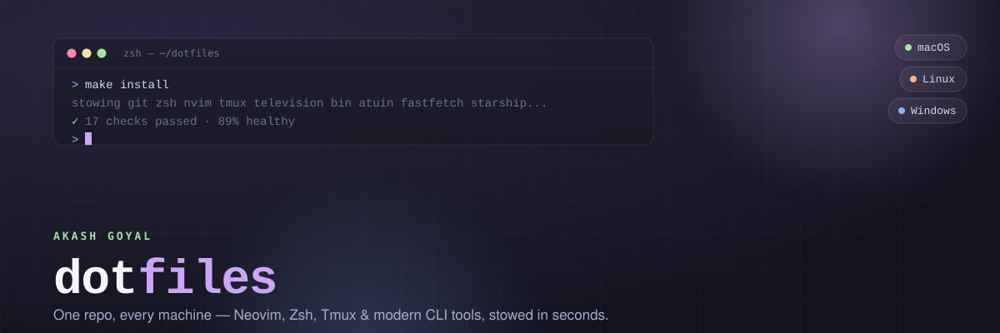

# dotfiles

<p align="center">
  
</p>

<p align="center">
  <a href="https://github.com/itsmeakashgoyal/dotfiles/actions/workflows/build_and_test.yml"></a>
  <a href="https://opensource.org/licenses/BSD-2-Clause"></a>
  
  
  
  
  
</p>

One repo, one command: the same Zsh, Neovim, tmux, Git and modern CLI setup on
**macOS**, **Linux** and **Windows**, in Gruvbox Dark.

> These dotfiles are personal and overwrite existing configs. Fork and review before running.

<p align="center">
  
</p>

## Install

**macOS / Linux** (no git or SSH key needed):

```bash
bash -c "$(curl -fsSL https://raw.githubusercontent.com/itsmeakashgoyal/dotfiles/master/bootstrap.sh)"
```

or from a clone: `git clone https://github.com/itsmeakashgoyal/dotfiles ~/dotfiles && cd ~/dotfiles && make install`
(add `dry=1` to preview).

**Windows** (PowerShell):

```powershell
Set-ExecutionPolicy -ExecutionPolicy RemoteSigned -Scope CurrentUser
irm https://raw.githubusercontent.com/itsmeakashgoyal/dotfiles/master/windows/install.ps1 | iex
```

**Then, on every new machine:**

```bash
dutils init     # git identities + SSH keys, theme, private overrides
exec zsh
```

## Everyday use

| Command | Does |
| --- | --- |
| `dutils menu` | Pick any `dutils` command from a fuzzy menu |
| `dutils update` | Update packages, plugins, Neovim |
| `dutils health` | Check that everything is linked and installed |
| `dutils git-setup status` | Which git identity / SSH key this repo uses |
| `dutils theme dark\|light\|auto` | Switch the terminal theme |
| `dutils bench --real` | Measure shell speed (zsh-bench) |
| `make help` | All install / stow targets |

Keybindings, aliases and every command: **[docs/CHEATSHEET.md](docs/CHEATSHEET.md)**.

## What's included

| Area | Tools |
| --- | --- |
| Shell | Zsh + zinit, Powerlevel10k (starship fallback), atuin, zoxide, television, vi mode |
| Editor | Neovim (lazy.nvim, LSP, Harpoon), Sublime Text |
| Terminal | iTerm2 Dynamic Profile (⌥Space drop-down), tmux |
| CLI | eza, bat, fd, ripgrep, delta, yazi, gh |
| Languages | Python 3.14 via mise + uv |
| Git | Per-repo work/personal identity and SSH key (`dutils git-setup`) |
| Packages | One manifest (`packages.toml`) → Homebrew, Nix, Scoop |

## Docs

| Guide | For |
| --- | --- |
| [Setup](docs/SETUP.md) | Install, first run, git identities, updating, uninstalling, troubleshooting |
| [Cheatsheet](docs/CHEATSHEET.md) | Keys, aliases, tmux, Neovim, `dutils` and `make` commands |
| [Customize](docs/CUSTOMIZE.md) | Theme, prompt, iTerm2, Python, adding tools, machine-local settings |
| [Contributing](CONTRIBUTING.md) | Repo layout and rules for changes |

## License

BSD 2-Clause. See [LICENSE](LICENSE).
